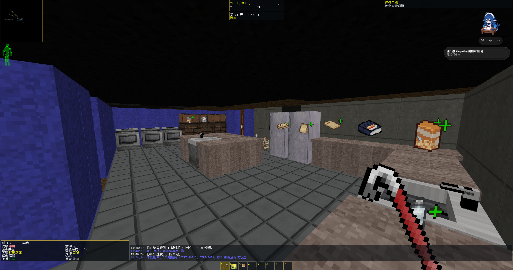

# CDDA Modern Mode

> **AI-generated project: This project was generated and developed with OpenAI GPT.** It is based on the open-source Cataclysm: Dark Days Ahead codebase and is not an official OpenAI or CDDA product.

[简体中文](README.zh-CN.md) · [Releases & downloads](https://github.com/Slime11123/cdda-modern-mode/releases) · [Development status](docs/DEVELOPMENT_STATUS.md) · [Upstream CDDA](https://github.com/CleverRaven/Cataclysm-DDA)

**CDDA Modern Mode** is an unofficial modernization project based on **Cataclysm: Dark Days Ahead (CDDA) 0.I-1 / Ito-1**. It adds experimental first-person 3D presentation, modern 2D controls, and mouse-friendly interfaces while preserving the original game's turn-based world, action-point costs, combat, and save mechanics.

> **Status: experimental Windows preview (November 2026).** Development builds may have crashes, compatibility issues, and inconsistent performance. This is not an official CDDA product, and full manual gameplay validation is still in progress.

## Download and play

Visit the [Releases page](https://github.com/Slime11123/cdda-modern-mode/releases) to see whether a Windows ZIP preview is available. Choose an asset labeled **Windows-x64**. GitHub's automatically generated **Source code** archives are *not* ready-to-play Windows builds.

1. **Extract the entire ZIP** to a writable folder outside `Program Files`. Do not launch the executable from inside the ZIP.
2. **Double-click `cataclysm-tiles.exe`** (the real game executable). No CMD or second EXE is needed in the Alpha.4 Windows package. Keep the DLLs, `data/`, `gfx/`, and `lang/` folders together.
3. Create a new world and character in-game. Saves and settings are stored under the extracted `user/` folder; back them up before upgrading.
4. Press **F5 or F6** to open the unified settings menu. Select the 2D/3D view, classic/modern controls, and classic sidebar/modern HUD independently, then apply and save.

The Windows package includes redistributable assets from the upstream-derived source tree, but does not bundle separately downloaded third-party tilesets. Please report issues in [GitHub Issues](https://github.com/Slime11123/cdda-modern-mode/issues).

## Recommended tileset: UndeadPeople

For the **best visual experience**, we recommend pairing CDDA Modern Mode with **UndeadPeople (MSX++UnDeadPeopleEdition)**, especially for 3D buildings, furniture, and item sprites.

> **The UndeadPeople tileset is not included, provided, or redistributed by this project.** It is a separate third-party resource. Download it yourself from its maintainers and follow its licensing and attribution terms. Since this project is based on CDDA 0.I-1, tileset compatibility may vary by version.

**Tileset repository and download:** [Xenikos / UndeadPeopleTileset on GitHub](https://github.com/Xenikos/UndeadPeopleTileset).

To install, copy the downloaded `MSX++UnDeadPeopleEdition` folder into the game's `gfx/` directory. In-game, go to **Options → Graphics → Choose Tileset** and select **UNDEAD_PEOPLE** (or its corresponding name). Restart the game if necessary.

## In-game demonstration

Actual first-person 3D gameplay screenshot supplied by the project developer:

*Development screenshot. Visual appearance depends on your selected tileset and game version.*

## Features

| Area | Development implementation |
| --- | --- |
| **Independent view, controls, and HUD** | Unified F5/F6 settings for 2D/3D presentation, classic/modern bindings, and sidebar/modern HUD |
| **Modern 2D** | WASD, smooth 360° circular camera panning, integrated Tab survival menu, map right-click context menu, and Q action wheel; shared workbench and NPC interfaces |
| **First-person 3D** | Terrain, multi-floor buildings, stairs/ramps, sky and distant scenery, furniture, visible entities, and materials from the selected tileset |
| **Interaction and combat** | Target reticle/outline, E context wheel, Q action wheel, aimed melee/smash, and native confirmations and safety checks |
| **Survival interface** | Inventory/pockets, equipment, health, crafting, construction, map, missions, NPCs, mutations, bionics, and martial-arts entry points |
| **Crafting and building** | Recipe search/favorites/batches, workbench crafting, native material commitment and activities, stairs/ramps/furniture previews |
| **Furniture and vehicles** | Basic 3D tables, beds, chairs, cupboards, crates, shelves, per-face textures and partial wall-aware orientation; vehicle work interface is evolving |
| **NPC interaction** | Mouse dialogue, portraits, two-column trade, selected guard/follow commands, and native resolution |

These features exist in the development code; not all workflows have passed full real-player or cross-device acceptance tests. Complex operations may still use original CDDA dialogs.

## Controls

| Action | Default input |
| --- | --- |
| Unified mode, controls, HUD settings | **F5 / F6** |
| Movement | **WASD** in modern modes (camera-relative in 3D, planar in 2D) |
| Look / pan | Mouse movement (behavior depends on mode) |
| Integrated survival panel | **Tab** |
| 3D interact / hold for context wheel | **E** |
| Quick action wheel | **Q** |
| Modern 2D map context menu | **Right click** on the map |
| 3D aimed melee or smash | **Left click**, subject to native target checks |

Binding overrides are supported. Display and control modes do not replace native combat and turn rules.

## Status and source build

Ongoing work includes complex-scene performance, detailed vehicles/furniture, end-to-end manual input checks, Chinese IME behavior, and broad hardware/mod compatibility. Automated test passes in reports should not be read as full release certification.

- [Development status](docs/DEVELOPMENT_STATUS.md) · [Progress log](docs/FP3D_PROGRESS.md) · [Modern controls](docs/FP3D_0I1_MODERN_CONTROLS.md)
- [Unified mode settings](docs/FP3D_MODE_SETTINGS.md) · [Modern 2D context menu](docs/MODERN_2D_CONTEXT_MENU.md) · [Shared modern interfaces](docs/MODERN_2D_SIMPLE_INTERACTIONS.md)
- [Native construction](docs/FP3D_CONSTRUCTION_START.md) · [Furniture orientation](docs/FP3D_FURNITURE_FACING.md) · [Vehicle design notes](docs/FP3D_VEHICLE_VISUAL_DESIGN.md)

Development platform: **Windows / CMake / SDL2 Tiles / OpenGL**. See the [upstream CMake build instructions](doc/c++/COMPILING-CMAKE.md) and enable `TILES=ON`, `ENABLE_FP3D=ON`. The local `tools/run-fp3d.ps1` depends on a prebuilt runtime outside the source repository and is **not** a public installer.

## Licensing and attribution

This is an independent GitHub repository, **not an official CDDA release**. Upstream authors and contributors remain credited.

- Upstream: [CleverRaven/Cataclysm-DDA](https://github.com/CleverRaven/Cataclysm-DDA), based on official `0.I-1` (`7b2efa5cea38e4d4d97dd0e63b28b9148623da59`).
- Main upstream code/content is **CC BY-SA 3.0**. Fonts, libraries, and certain assets carry separate licenses; see [LICENSE.txt](LICENSE.txt), [attribution notes](docs/ATTRIBUTION.md), and [upstream README](docs/UPSTREAM_README.md).
- Redistributable packages must retain the relevant notices and exclude personal saves, test artifacts, and separately obtained assets whose rights are not confirmed.

Please report bugs and suggestions via [Issues](https://github.com/Slime11123/cdda-modern-mode/issues).
