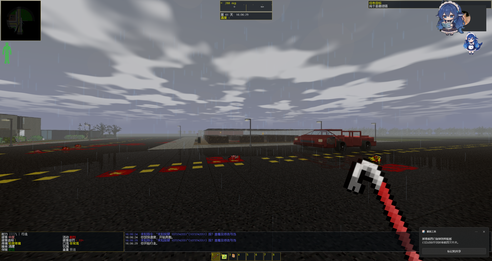
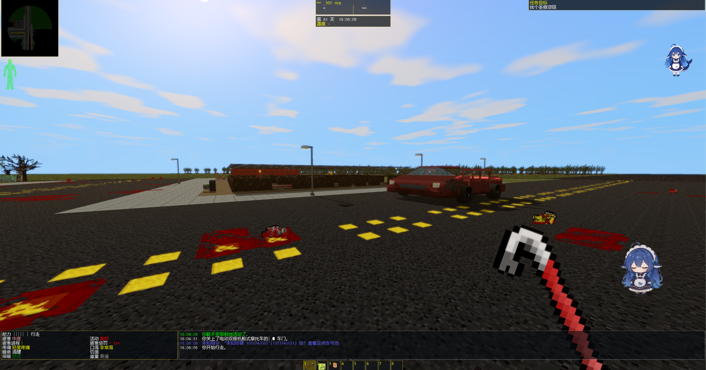
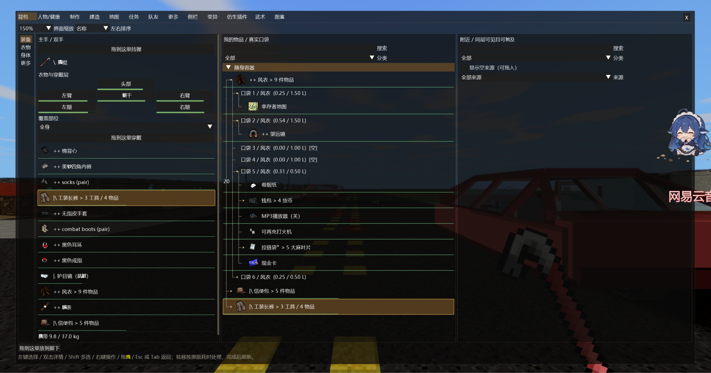

# CDDA Modern Mode

**An experimental first-person 3D and modern controls experience for Cataclysm: Dark Days Ahead.**

> **AI-generated development:** This project was generated and developed with OpenAI GPT. It is an **unofficial** project based on CDDA **0.I-1 (Ito-1)**, not a release from OpenAI or the CDDA maintainers.

[简体中文](README.zh-CN.md) · [**Download for Windows**](https://github.com/Slime11123/cdda-modern-mode/releases) · [Report an issue](https://github.com/Slime11123/cdda-modern-mode/issues) · [Development notes](docs/DEVELOPMENT_STATUS.md)

---

## First-person CDDA, with the original survival simulation

Explore CDDA's world in a first-person 3D perspective, or switch back to classic 2D at any time. Modernized WASD movement, mouse aiming and integrated survival menus sit on top of CDDA's original turn-based rules, combat statistics, world generation and save system.

| 3D world | Modern survival experience | Experimental graphics |
| :--- | :--- | :--- |
| Multistorey buildings, furniture, vehicles, sprites and weather | Mouse-first interaction, context wheels, inventory, crafting and HUD | OpenGL, lighting, dynamic sunlight shadows, reflections and configurable visual quality |

## In-game showcase

| Rainy weather — wet road reflections | Clear weather — sky and sunlight |
| :---: | :---: |
|  |  |

**Indoor 3D and furniture**

**Modern inventory and nested pockets**

*Actual development screenshots supplied by the developer. Graphics and performance depend on settings and hardware.*

## What's new — Alpha 0.3.1

**Performance & interface-size update (November 8, 2026).** See [the full 0.3.1 changelog](docs/RELEASE_NOTES_alpha0.3.1.md).

- **Faster 3D scene preparation:** reuse prepared map caches, reduce redundant scene-capture work and avoid repeated full-scene stair linkage.
- **Less unnecessary GPU work:** avoid the wet-reflection mask pass when a scene contains no relevant reflective surfaces; streamline vehicle visibility calculations.
- **More legible first launch on Windows:** increase the default UI/font dimensions without enlarging the initial window. Existing user settings are respected.
- **Carry forward Alpha 0.3.0:** multistorey geometry, vehicle improvements, modern interaction and the experimental Photon-style shadow, sky and reflection pipeline.

*These are targeted optimizations, not a promise of a specific FPS increase. GPU and gameplay-wide performance still require testing on different PCs.*

## Download and install (Windows x64)

1. Open [GitHub Releases](https://github.com/Slime11123/cdda-modern-mode/releases) and download the newest **Windows-x64 ZIP**. GitHub's automatic **Source code** ZIP is not a playable game package.
2. **Extract the complete ZIP** to a new writable folder. Keep the included DLLs and `data/`, `gfx/`, `lang/` and `config/` directories together.
3. **Double-click `cataclysm-tiles.exe`**. It is the only game EXE; no CMD, second launcher or special environment variables are needed.
4. Press **F5 / F6** to change 2D/3D, graphics, controls and HUD. Back up your `user/` saves and settings before upgrading.

A fresh install uses a larger, readable Windows 3D UI. Your already-saved font, terminal-size and scaling preferences are not forcibly reset.

## Controls

| Input | Purpose |
| :--- | :--- |
| **W / A / S / D** | Move (modern 2D/3D modes) |
| **Mouse** | Look, point and aim |
| **E** | Interact or choose a context direction; ladders and climbable pipes |
| **Q** | Quick action wheel |
| **Tab** | Open or close the integrated survival menu |
| **Z (3D)** | Crouch |
| **F5 / F6** | Unified display and control settings |

Game logic and many complex actions still use native CDDA validation and menus. Key bindings may be customized.

## Optional visuals — downloads not included

**Photon Shaders (recommended for lighting and atmosphere):** [Download from the author's Modrinth page](https://modrinth.com/shader/photon-shader/versions) · [Photon source](https://github.com/sixthsurge/photon). You can put a separately downloaded shader ZIP in `shaderpacks/` and select it using the F5/F6 shaderpack menu. **This project does not provide or redistribute Photon.** The current graphics bridge provides *Photon-style visual adaptation*, **not** complete Minecraft Iris/OptiFine multi-pass rendering; some shaderpack features may not work.

**UndeadPeople tileset (recommended for detailed sprite artwork):** [Xenikos/UndeadPeopleTileset](https://github.com/Xenikos/UndeadPeopleTileset). Install it separately under `gfx/` and select it in the game's graphics options. **This project does not include or redistribute UndeadPeople.** Compatibility varies with tileset versions.

Third-party authors retain their own rights and license conditions. Neither Photon nor UndeadPeople is in the downloadable game ZIP.

## Status, development and licenses

**Alpha — work in progress.** Real-world gameplay, FPS on diverse GPUs, shaderpack versions, vehicle interiors, complex buildings, mods and old save migration have not all been exhaustively verified.

- [Alpha 0.3.1 release notes](docs/RELEASE_NOTES_alpha0.3.1.md) · [Shaderpack compatibility](docs/MC_SHADERPACK_COMPATIBILITY.md) · [3D progress](docs/FP3D_PROGRESS.md)
- [Development status](docs/DEVELOPMENT_STATUS.md) · [Modern controls](docs/FP3D_0I1_MODERN_CONTROLS.md) · [Attribution](docs/ATTRIBUTION.md)
- Developers: Windows, CMake, SDL2 Tiles, OpenGL; enable `TILES=ON` and `ENABLE_FP3D=ON`. See [CMake compiling guide](doc/c++/COMPILING-CMAKE.md).

CDDA is developed by its original community: [CleverRaven/Cataclysm-DDA](https://github.com/CleverRaven/Cataclysm-DDA). Main upstream material is under **CC BY-SA 3.0**; bundled fonts, runtime libraries and some assets have separate licenses. Respect the notices in [LICENSE.txt](LICENSE.txt) and [ATTRIBUTION.md](docs/ATTRIBUTION.md).

---

**CDDA Modern Mode is a fan/development project — not an official CDDA or OpenAI game.**
