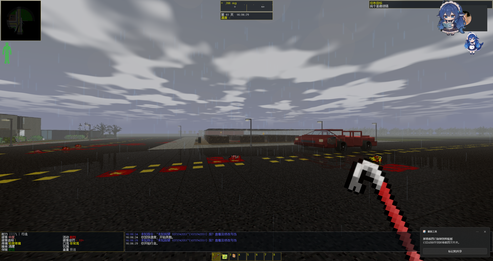
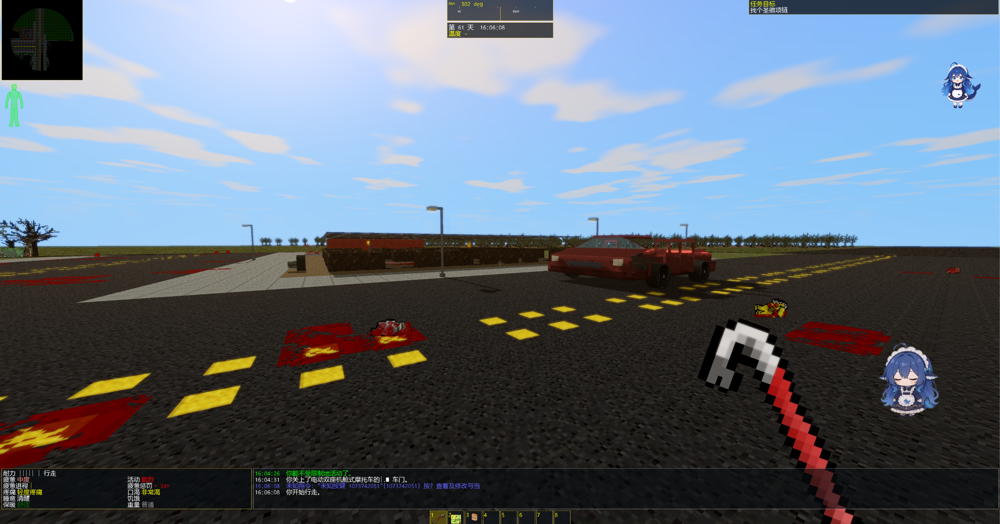
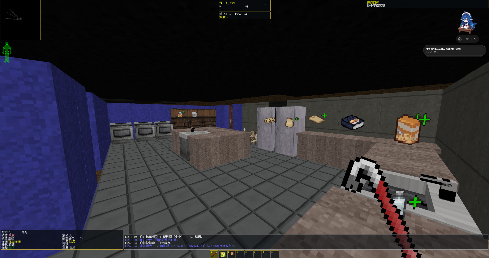

# CDDA Modern Mode

**让《大灾变：浩劫余生》（CDDA）拥有第一人称 3D 画面与现代化操作。**

> **AI 生成项目声明：** 本项目由 OpenAI GPT 生成并协助开发，基于 CDDA 官方 **0.I-1（Ito-1）** 源码独立开发。项目为**非官方衍生版本**，不代表 OpenAI 或 CDDA 官方。

[English](README.md) · [**下载 Windows 游戏**](https://github.com/Slime11123/cdda-modern-mode/releases) · [提交问题反馈](https://github.com/Slime11123/cdda-modern-mode/issues) · [开发状态](docs/DEVELOPMENT_STATUS.md)

---

## 在第一人称世界中体验 CDDA

探索第一人称 3D 建筑、车辆、家具、天气与怪物，同时保留 CDDA 原本的回合制行动、枪械技能、战斗结算、世界生成与存档逻辑。玩家可以随时切换经典 2D 与现代 3D，无需重新启动游戏。

| 3D 世界 | 现代生存操作 | 实验性光影 |
| :--- | :--- | :--- |
| 多层建筑、家具、车辆、天气和精灵素材 | WASD、鼠标准星、交互轮盘、背包与生存综合菜单 | OpenGL、HDR、太阳阴影、雨天反射与光影质量设置 |

## 实机画面

| 雨天：云层、降雨与地面反射 | 晴天：蓝天、阳光与车辆阴影 |
| :---: | :---: |
|  |  |

**3D 室内与家具场景**

*以上均为开发者提供的真实游戏截图；画面效果、帧数与所选图块包和电脑硬件有关。*

## Alpha 0.3.1：性能与界面缩放优化

本版重点是 **2026 年 11 月 8 日的性能优化、玩家版界面缩放一致性修复**。详见 [Alpha 0.3.1 完整更新日志](docs/RELEASE_NOTES_alpha0.3.1.md)。

- **减少场景准备开销：** 复用地图缓存、减少重复场景快照工作，避免每回合对楼梯连接进行不必要的全量扫描。
- **降低渲染负担：** 场景无相关反光表面时跳过湿路反射遮罩 Pass，优化车辆可见性距离计算。
- **修复玩家版界面过小：** 调整 Windows 3D 首次启动的默认字体及终端网格，让文字与菜单更清楚，同时尽量维持原有窗口大小。
- **保留 Alpha 0.3.0 特性：** 多层建筑、车辆立体结构、现代射击与交互，以及 Photon 风格的天空、阴影和反射。

*优化不等于所有电脑都能获得固定帧数提升。实际 FPS 受 CPU、GPU、地图复杂度和画质影响，仍需更大范围测试。*

## Windows x64 下载与安装

1. 前往 [GitHub Releases 下载页面](https://github.com/Slime11123/cdda-modern-mode/releases)，选择最新版带 **Windows-x64** 名称的 ZIP。GitHub 自动生成的 **Source code** 压缩包不是可直接游玩的游戏。
2. 将 ZIP **完整解压**到可写入的新文件夹，保留全部 DLL 以及 `data/`、`gfx/`、`lang/`、`config/` 目录。
3. **直接双击 `cataclysm-tiles.exe`**，无需 CMD、第二个启动器或特殊环境变量。
4. 按 **F5/F6** 更改 2D/3D、控制方式、HUD 和光影质量。升级前备份旧版 `user/` 存档与设置。

全新安装会采用更清楚的 Windows 3D 字体大小；已有玩家自行保存的字体、终端尺寸和缩放设置不会被强制清除。

## 默认操作

| 按键 | 操作 |
| :--- | :--- |
| **W / A / S / D** | 现代模式移动 |
| **鼠标** | 观察、准星瞄准和物体选择 |
| **E** | 交互、方向选择、爬梯及攀爬水管 |
| **Q** | 快捷行动轮盘 |
| **Tab** | 打开／关闭综合生存菜单 |
| **Z（3D 模式）** | 蹲伏 |
| **F5 / F6** | 统一画面、操作与 HUD 设置 |

所有重要行动仍遵循原版 CDDA 的行动点、技能和规则；复杂操作可能沿用原版对话框。

## 推荐第三方资源（本项目均不提供）

**Photon 光影包 — 推荐搭配使用：** [Photon 官方 Modrinth 下载](https://modrinth.com/shader/photon-shader/versions) · [作者 GitHub 仓库](https://github.com/sixthsurge/photon)。玩家可自行把下载的 ZIP 放入 `shaderpacks/`，在 F5/F6 光影菜单扫描选择。**本仓库及发行包不提供、不捆绑、不重新分发 Photon。** 当前采用的是 CDDA 自身的 **Photon 风格视觉适配**，不是完整运行 Minecraft Iris/OptiFine 的原版多 Pass 光影。

**UndeadPeople（不死人）图块包 — 推荐搭配使用：** [维护者 GitHub 仓库](https://github.com/Xenikos/UndeadPeopleTileset)。请自行下载安装到 `gfx/` 并在游戏选项中选择。**本项目不提供、不捆绑、不重新分发不死人图块包。** 不同图块版本可能存在兼容问题。

所有第三方素材均归原作者所有，请遵守其授权与署名要求。

## 开发状态与开源许可

本项目仍是 **Alpha 实验版**，复杂车辆、跨层建筑、不同光影包、硬件兼容、长时间生存和旧存档迁移等方面尚未完成全面验收。

- [Alpha 0.3.1 更新日志](docs/RELEASE_NOTES_alpha0.3.1.md) · [光影兼容性说明](docs/MC_SHADERPACK_COMPATIBILITY.md) · [3D 开发进度](docs/FP3D_PROGRESS.md)
- [开发状态](docs/DEVELOPMENT_STATUS.md) · [现代化操作](docs/FP3D_0I1_MODERN_CONTROLS.md) · [版权署名](docs/ATTRIBUTION.md)
- 开发构建：Windows / CMake / SDL2 Tiles / OpenGL，配置 `TILES=ON` 与 `ENABLE_FP3D=ON`，参考 [CMake 编译指南](doc/c++/COMPILING-CMAKE.md)。

CDDA 原始项目与贡献者见 [CleverRaven/Cataclysm-DDA](https://github.com/CleverRaven/Cataclysm-DDA)。上游主要源码与内容采用 **CC BY-SA 3.0**，字体、运行库等组件可能有单独许可证。参见 [LICENSE.txt](LICENSE.txt) 和 [版权说明](docs/ATTRIBUTION.md)。

---

**CDDA Modern Mode 是非官方的玩家／开发者项目，而非 CDDA 或 OpenAI 官方游戏。**
