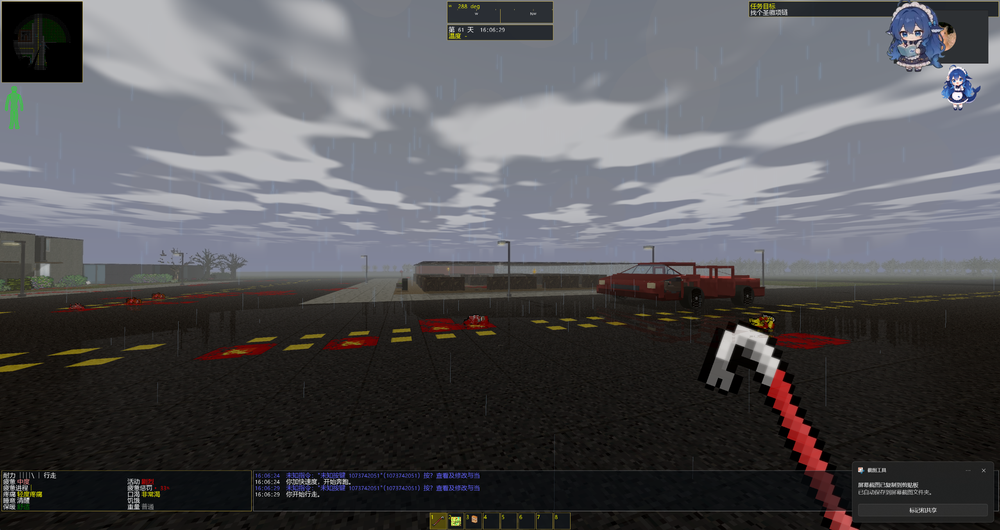
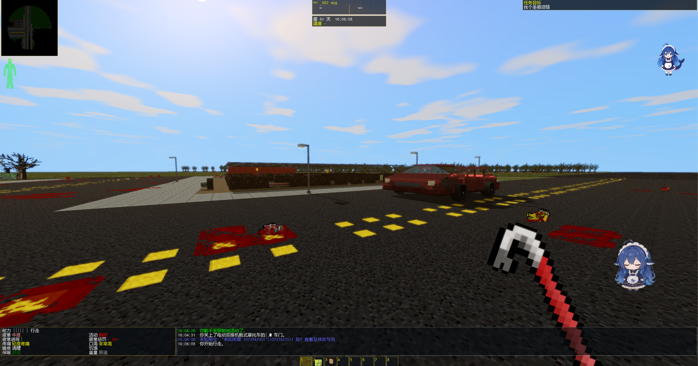

# CDDA Modern Mode — Alpha 0.3.1

**版本标签：`alpha0.3.1`｜2026-11-08｜Windows x64｜CDDA 0.I-1（Ito-1）**

> 实验性性能与界面缩放修复版本。项目由 OpenAI GPT 生成并协助开发，是 CDDA 的非官方衍生项目，不代表任何官方稳定版。

## 本次更新

### 1. 游戏界面缩放与首次启动

- 解决玩家发行版初始主菜单、提示文字和 ASCII 标志相对开发测试版本过小的问题：Windows FP3D 构建首次启动字体格子从 **8×16** 调整到 **12×24**，字体字号从 **16** 调整为 **24**。
- 默认终端网格由 **180×60** 调整到 **120×40**，使初始窗口的像素大小大致保持一致（约 1440×960，实际根据操作系统 DPI 与窗口边框有差异）。
- **只修改无个人配置的新安装默认值**，不自动覆盖已有用户的字体、窗口和缩放设置；切换 2D/3D 和窗口调整仍可自行保存。
- 发行包不复用旧安装残留的 `config/options.json` 或 `debug.log`，避免上次遇到的巨型终端格数、错误渲染器或强制 2D 设置影响新用户。

### 2. CPU 场景准备性能优化

- 3D `prepare_view` 直接复用本轮已准备的地图缓存和可见性结果，避免同一次移动重复进行全楼层可见性工作。
- 减少多层地图中不必要的可见性与遮挡检查；家具图块资源 ID 查询和快照准备减少重复处理。
- 场景快照中记录楼梯连接状态，避免 `capture()` 之后在每次 `publish()` 再次遍历场景、寻找并排序同一批楼梯。
- 现有本地对照记录：固定种子 424242 的移动场景快照平均耗时从 **15.32 ms / 16.20 ms（两种旧配置）降低到 13.87 ms**，约为 **9%～14%** 的 CPU 快照准备耗时下降。这**不是整机 FPS 提升百分比**；不同地图和显卡可能不同。详见 [移动性能测试记录](FP3D_MOVEMENT_PERFORMANCE_20261108.md)。

### 3. GPU 渲染与车辆性能

- 当没有可见水面/湿地等相关反光材质时，不再执行额外的反射遮罩 FBO Pass，也避免对无意义的反射纹理进行后处理采样。
- 优化车辆视锥裁剪：用挂载位置的平方距离计算最大包围半径，每辆车仅在最后求一次平方根，减少逐部件昂贵计算。
- 保留 0.3.0 版本的 Photon 风格太阳阴影、天空、天气和湿路反射。没有擅自改变原版回合制、AI、物理碰撞或存档逻辑。

## 实机展示

| 雨天光影 | 晴天光影 |
| :---: | :---: |
|  |  |

## 玩家下载与安装

1. 在 [Releases 页面](https://github.com/Slime11123/cdda-modern-mode/releases) 获取 `CDDA-Modern-Mode-alpha0.3.1-Windows-x64.zip`。GitHub 自动生成的 Source code ZIP 不是可玩的游戏。
2. **完整解压**到新的可写文件夹；直接双击唯一的 `cataclysm-tiles.exe`。不需要 CMD、第二个启动器或设置特殊环境变量。
3. 保留随包 DLL、`data/`、`gfx/`、`lang/`、`config/`。升级之前先备份 `user/` 存档、设置与图块包。
4. 现有旧版用户如果已经有自己的字体与缩放设置，可自行在图形选项中调整，**新版本不会覆盖旧设置**。

## 第三方图块与光影（均不随包分发）

- 推荐 Photon 光影包：[作者 Modrinth 下载](https://modrinth.com/shader/photon-shader/versions)／[GitHub 源码](https://github.com/sixthsurge/photon)。本项目只提供实验性的 Photon 风格渲染适配，**不运行完整 Minecraft Iris/OptiFine 原版多阶段光影**，不包括任何 Photon 素材。
- 推荐 UndeadPeople 图块包：[维护者仓库](https://github.com/Xenikos/UndeadPeopleTileset)。本项目**不提供、不捆绑、不重新分发**，请自行安装并遵守其许可。

## 发行测试与限制

- 发布时从与对应 Git Tag 相同的源码重新编译 Windows x64 SDL2/Tiles + `ENABLE_FP3D=ON`，只分发一个真实 `cataclysm-tiles.exe`。
- 核对项目构建、JSON 数据、独立 ZIP 解压后的无参数 EXE 进入 3D/OpenGL、可调整窗口，以及首次启动字体/终端默认值。
- **尚未完整验证：** 复杂存档迁移、全部家具车辆、所有 Photon 版本兼容、光影全开下的 GPU 帧时间、不同 DPI/显示器、长时间游玩。
- 具体构建提交、Windows ZIP 的大小、SHA-256 和测试结果见 GitHub Release 发布页面及附件 `SHA256SUMS.txt`。

---

## English summary

**Alpha 0.3.1** is an experimental **performance and player UI scaling** release. Fresh Windows 3D installs use **12×24 font cells and a 120×40 initial terminal**, preserving approximately the same initial window dimensions while making the menu and text more readable. Saved personal settings are not overwritten.

The update reduces repeated 3D scene preparation and stair-linking work, skips dry-scene wet-reflection passes, and optimizes per-vehicle frustum radius calculations. A fixed-scene CPU snapshot benchmark reported **13.87 ms versus 15.32–16.20 ms previously**, which is a targeted CPU timing improvement, **not a measured increase in overall FPS**.

**Photon and UndeadPeople are third-party downloads and are not bundled or redistributed.** This experimental project remains unaffiliated with CDDA or OpenAI official releases.
